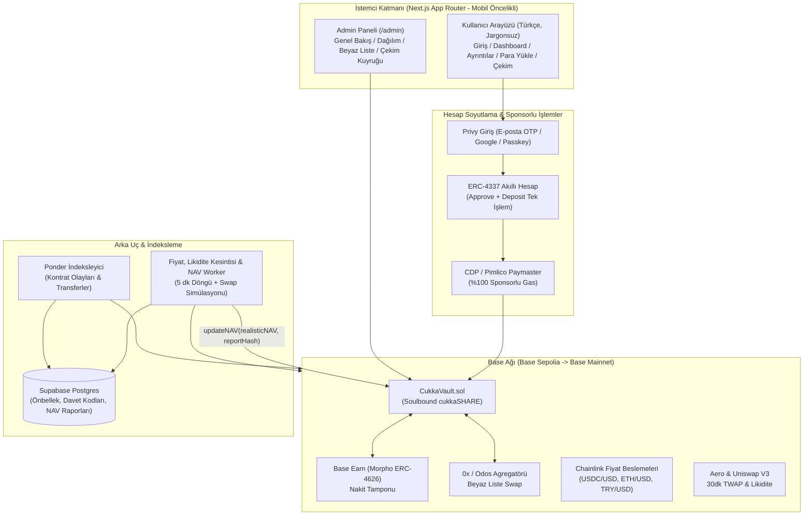

# CUKKA — Yalın Kripto Portföy Kasası (V1)

Kripto bilmeyen kullanıcıların e-posta veya Google ile giriş yapıp, Base ağındaki **non-custodial** ortak portföy kasasına (`CukkaVault`) USDC yatırabildiği, yöneticinin yalnızca beyaz listedeki varlıklar arasında sınırlandırılmış swap yapabildiği ve nakit tamponun **Base Earn (Morpho)** kasasında değerlendirildiği davetiyeli portföy uygulaması.

> **"Paran yöneticinin cüzdanında değil, akıllı kontratta durur."**

---

## Mimari Diyagram



---

## Proje Fazları

- [x] **Faz 0 — Netleştirme:** Teknik tasarım dokümanı ([`docs/TECHNICAL_DESIGN.md`](docs/TECHNICAL_DESIGN.md)), Türkiye cüzdan karşılaştırması ve 7 mimari kararın onaylanması.
- [x] **Faz 1 — Kontratlar (Yerel Derleme, Test & Kapsam Tamamlandı / Base Sepolia Yayın Adımı):**
  - [`contracts/src/CukkaVault.sol`](contracts/src/CukkaVault.sol): Soulbound `cukkaSHARE`, HWM performans ücreti kristalizasyonu, 24s timelock'lu beyaz liste, slippage / pozisyon üst sınırı / nakit tamponu / günlük swap hacmi korumaları, `±20%` NAV devre kesici, `Pausable` çekim garantisi.
  - [`contracts/test/CukkaVault.t.sol`](contracts/test/CukkaVault.t.sol): 13 test senaryosu + 1.000 koşulu Fuzz testi (**%95.68 Satır Kapsamı, %100 Fonksiyon Kapsamı**).
- [ ] **Faz 2 — Backend:** Ponder indeksleyici, 5 dakikalık Fiyat/Likidite Kesintisi/NAV worker, rebalance simülatörü ve çekim kuyruğu API'si.
- [ ] **Faz 3 — Kullanıcı Arayüzü:** Davet kodlu giriş, Dashboard, Ayrıntılar, Para Yükle (Türk borsaları rehberi + QR + Kartla Yükle) ve Çekim ekranları.
- [ ] **Faz 4 — Admin Paneli:** `/admin` yönetim ve simülasyon arayüzü.
- [ ] **Faz 5 — Sertleştirme:** Slither + Aderyn statik analiz, uç durum testleri ve Base Mainnet geçiş planı.

---

## Faz 1 Test & Kapsam Raporu

| Dosya | Satır Kapsamı (% Lines) | İfade Kapsamı (% Statements) | Fonksiyon Kapsamı (% Funcs) | Durum |
| :--- | :---: | :---: | :---: | :---: |
| `src/CukkaVault.sol` | **%95.68 (310/324)** | **%89.68 (391/436)** | **%100.00 (33/33)** | ✅ Geçti (13/13 Test + 1000 Fuzz) |

---

## Tek Komutla Kurulum ve Test

```bash
# Kontratları derle ve tüm birim + fuzz testlerini çalıştır
npm test

# Kapsam (coverage) raporunu üret
npm run contracts:coverage

# Base Sepolia ağına dağıt ve doğrula
npm run contracts:deploy:sepolia
```
