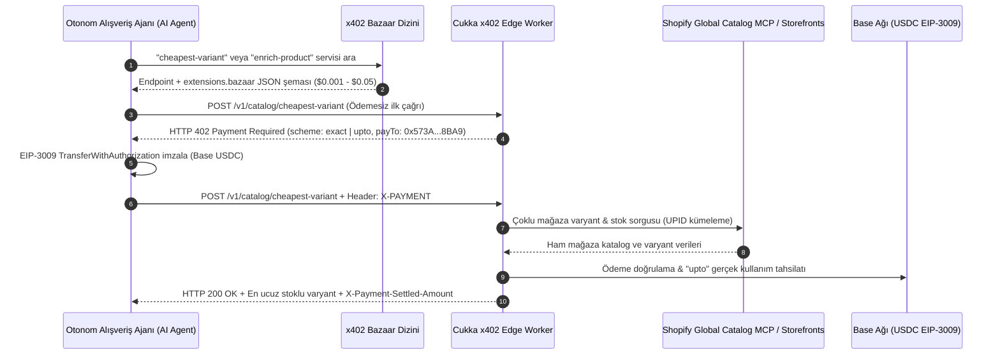

# CUKKA x402 — Shopify Global Catalog Agent Data Layer

Otonom yapay zeka ajanları (AI Agents) için **Shopify Global Catalog MCP** (`catalog.shopify.com/api/ucp/mcp`) ve çoklu Shopify mağaza katalogları üzerinde çalışan, **Coinbase x402 (`HTTP 402 Payment Required`)** protokolü ve **Bazaar keşif uzantısı (`extensions.bazaar`)** ile çağrı başına **`$0.001 – $0.05 USDC`** (Base Sepolia & Base Mainnet) mikro-ödemeyle çalışan veri katmanı.

🔗 **Canlı Ajan Konsolu & x402 Oyun Alanı:** `https://cukka.org/app.html`  
🔗 **x402 Bazaar Keşif Manifestosu:** `https://cukka.org/.well-known/x402-bazaar.json`

---

## Mimari Diyagram

---

## x402 Uç Noktaları ve Fiyatlandırma Tablosu

| Uç Nokta (Endpoint) | Şema (`scheme`) | Fiyat (Base USDC) | Açıklama |
| :--- | :---: | :---: | :--- |
| `POST /v1/catalog/cheapest-variant` | `exact` | **$0.002** (`2000` atomic) | Mağazalar arası fiyat karşılaştırma, stoksuz varyantları eleme ve **en ucuz stoklu varyantı** doğrudan sepet linkiyle bulma. |
| `POST /v1/catalog/enrich-product` | `upto` | **Maks. $0.025** *(Ort. ~$0.006)* | Ürün verisi zenginleştirme: kategori normalizasyonu, TR/EU/US beden tablosu ve uyumluluk analizi (LLM token kullanımına göre dinamik ücretlendirme). |
| `POST /v1/catalog/price-stock-watch` | `exact` | **$0.001** (`1000` atomic) | Gerçek zamanlı stok/fiyat değişim takibi (restock sinyali ve 30 günlük fiyat farkı). |
| `POST /v1/catalog/niche-match` | `upto` | **Maks. $0.050** *(Ort. ~$0.014)* | Belirli nişte arama: kozmetik içerik (INCI) eşleştirme, yedek parça uyumluluğu ve bütçe kısıtlı hediye önerisi. |
