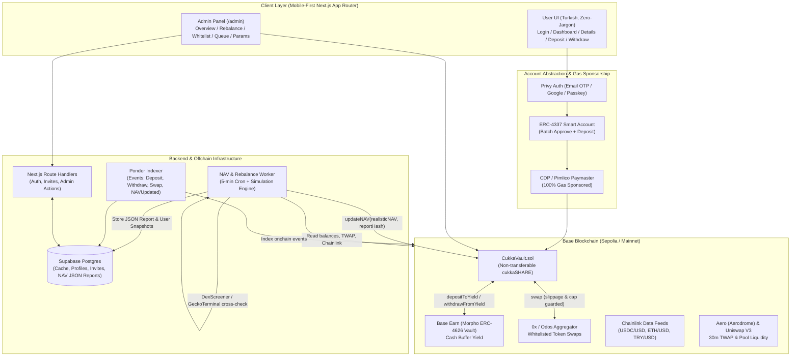

# CUKKA V1 — Technical Design Document (Phase 0 — Approved)

**Status:** Approved (Phase 0 Locked)  
**Target Chain:** Base Sepolia (Testnet) $\rightarrow$ Base Mainnet  
**Core Principle:** Non-custodial pooled portfolio vault ("Your funds are in the smart contract, never in the manager's wallet") with zero crypto jargon for end users.

## Finalized Phase 0 Decisions
1. **Wallet & Auth:** Privy Embedded Wallet (Email OTP, Google, Passkey) + ERC-4337 Smart Account with Paymaster sponsorship.
2. **Hosting & Deployment:** Existing GitHub Pages pipeline (`cukka.org/index.html` for Coming Soon, `cukka.org/app.html` for the live application) preserved.
3. **Partial Withdrawal HWM & Fee Crystallization:** Option A — Performance fee is crystallized strictly on the withdrawn shares (`sharesWithdrawn`), paid in `cukkaSHARE` to `feeRecipient`. The user's remaining shares keep their existing `highWaterMark` so partial withdrawals cannot be gamed to reset HWM without paying fees.
4. **Withdrawal Lock & Transparency (`requestWithdraw`):** Both `lockedNavPerShare`, `feeShares`, and `netUsdcPayout` are locked and calculated at the moment `requestWithdraw` is called, stored onchain in the `WithdrawRequest` struct, and displayed upfront to the user so every party knows exact numbers with zero surprises.
5. **Testnet Environment:** All Phase 1–4 deployments and tests run against real contracts and real state on **Base Sepolia Testnet**.
6. **Card On-Ramp:** Enabled in the "Para Yükle" screen as a secondary option alongside the high-commission disclaimer.
7. **Withdrawal Queue Flow:** Standard `requestWithdraw`, `cancelWithdraw` (by user), and `processWithdraw` (by `ADMIN_ROLE`).

---

## 1. System Architecture Overview

---

## 2. Smart Contract Design (`CukkaVault.sol`)

Following **ethskills.com** (`ship`, `security`, `building-blocks`, `concepts`), the MVP uses a **single core contract** (`CukkaVault.sol`) inheriting OpenZeppelin v5 `ERC20` (non-transferable `cukkaSHARE`), `AccessControl`, `Pausable`, and `ReentrancyGuard`.

### 2.1 Precision, Decimals & Inflation Attack Mitigation
- **Base Asset:** Circle Native USDC (`6 decimals`).
- **Share Decimals:** `18 decimals` (using a `1e12` decimal offset, or `6 decimals` with `1000` dead shares minted to `0x000000000000000000000000000000000000dEaD` on initial deposit).
- **Minimum Initial Deposit:** Enforced on the first deposit (e.g., `100 USDC` = `100e6`) alongside dead shares so share-price manipulation / inflation attacks are economically impossible.
- **Rounding Direction:** All share calculations use `Math.mulDiv` with explicit rounding in favor of the vault:
  - `deposit`: rounds **down** (`Math.Rounding.Floor`) shares minted to user.
  - `requestWithdraw` / `processWithdraw`: rounds **down** (`Math.Rounding.Floor`) USDC paid out to user.

### 2.2 Role Matrix & Hard Guardrails ("Nothing Is Automatic")
| Role | Holder | Permitted Actions | Hard Onchain Constraints |
|------|--------|-------------------|--------------------------|
| `DEFAULT_ADMIN_ROLE` / `ADMIN_ROLE` | Multisig (Safe 2/3) | Queue token whitelist, remove token immediately, process withdraw queue, adjust parameters within bounds, pause/unpause | **Cannot withdraw user funds.** Token additions require `whitelistTimelock` (24h default). Fee increases require timelock; fee decreases are instant. |
| `MANAGER_ROLE` | Multisig / Dedicated Hardware Key | `swap()`, `depositToYield()`, `withdrawFromYield()` | Can only swap between active whitelisted tokens via allowlisted aggregator router. Enforces: (1) max slippage (`300 bps`), (2) max single-token allocation cap (default `1000 bps` = 10% of NAV), (3) minimum cash buffer (`1000 bps` = 10% of NAV in idle USDC + Morpho vault), (4) 24h rolling swap volume cap. |
| `ORACLE_ROLE` | Dedicated Backend Hot Key | `updateNAV(uint256 totalAssetsUsdc, bytes32 reportHash)` | Reverts if `abs(newNAV - oldNAV) / oldNAV > maxNavDeltaBps` (default 20%) unless co-signed/approved by `ADMIN_ROLE`. |

### 2.3 High-Water Mark (HWM) & Performance Fee Crystallization
- Each user state tracks:
  - `costBasisUsdc`: cumulative net USDC principal deposited.
  - `highWaterMark`: price per share in USDC (`1e18` scaled) above which performance fees apply.
- **On Deposit (`deposit(uint256 usdcAmount)`):**
  - Requires fresh NAV (`block.timestamp - lastNavTimestamp <= maxNavAge`).
  - Pulls `usdcAmount` via `SafeERC20.safeTransferFrom`.
  - Mints `sharesNew = (usdcAmount * totalSupply) / currentTotalNavUsdc`.
  - Updates user's weighted-average `highWaterMark`:
    $$\text{HWM}_{\text{new}} = \frac{(\text{shares}_{\text{old}} \times \text{HWM}_{\text{old}}) + (\text{shares}_{\text{new}} \times \text{NAV}_{\text{perShare}})}{\text{shares}_{\text{old}} + \text{shares}_{\text{new}}}$$
- **On Withdrawal Request (`requestWithdraw(uint256 shares)`):**
  - Works even when contract is `paused` (users are never locked out of requesting exit).
  - Transfers `shares` from user into vault escrow (`lockedShares`), records `lockedNavPerShare = currentNAVPerShare` and `userHwmSnapshot = user.highWaterMark`.
- **On Withdrawal Execution (`processWithdraw(uint256 requestId)`):**
  - If `lockedNavPerShare > userHwmSnapshot` and `performanceFeeBps > 0`:
    - Calculates profit per share: `profitPerShare = lockedNavPerShare - userHwmSnapshot`.
    - Calculates fee in shares:
      $$\text{feeShares} = \frac{\text{ profitPerShare} \times \text{sharesWithdrawn} \times \text{performanceFeeBps}}{10000 \times \text{lockedNavPerShare}}$$
    - Transfers `feeShares` to `feeRecipient` (as `cukkaSHARE`, preserving vault liquidity).
    - Burns `netShares = sharesWithdrawn - feeShares`.
    - Transfers `usdcPayout = netShares * lockedNavPerShare` in USDC to the user.

---

## 3. Offchain Engine: Pricing, Haircuts, Rebalancing & Indexing

### 3.1 Ponder Indexer
- Subscribes to `CukkaVault` events (`Deposited`, `WithdrawRequested`, `WithdrawProcessed`, `WithdrawCancelled`, `Swapped`, `YieldMovement`, `NAVUpdated`, `WhitelistQueued`, `WhitelistActivated`) and ERC-20 `Transfer` events to user smart accounts.
- Frontend reads historical series and activity logs from Postgres populated by Ponder — never polling RPC loops.

### 3.2 5-Minute NAV & Liquidity Haircut Worker
1. Reads vault balances of all whitelisted tokens + idle USDC + Morpho ERC-4626 shares (`convertToAssets`).
2. Determines each asset's spot/TWAP price:
   - **Tier 1 (Majors & FX):** Chainlink Data Feeds (`USDC/USD`, `ETH/USD`, `cbBTC/USD`, `TRY/USD`) with staleness checks (`updatedAt`).
   - **Tier 2 (Mid/Small Cap & Memecoins):** Reads 30-minute TWAP from the deepest Aero (Aerodrome) or Uniswap V3 pool on Base, cross-checked against DexScreener/GeckoTerminal API. If divergence $> 5\%$, takes `min(twapPrice, apiPrice)` and triggers an admin alert.
3. Applies parametric **Liquidity Haircut** based on `positionRatio = positionValueUsd / poolTotalLiquidityUsd`:
   - $< 1\%$: `0%` haircut
   - $1\% - 5\%$: `5%` haircut
   - $5\% - 10\%$: `15%` haircut
   - $> 10\%$: `30%` haircut
4. Computes **Paper Value** (unadjusted) and **Realistic Value** (post-haircut).
5. Saves full JSON breakdown to Supabase, computes `reportHash = keccak256(canonicalJson)`, and submits `updateNAV(realisticTotalUsdc, reportHash)` onchain.

### 3.3 Rebalance & Honeypot Guard
- Admin inputs target weights (`%`) and a mandatory Turkish rationale note (`gerekçe notu`).
- Worker fetches 0x / Odos quotes, simulates execution via `eth_call` (`stateOverride` / bundle simulation).
- **Honeypot / Tax Guard:** If simulated output $< 97\%$ of quoted output, the swap is blocked and the token is flagged in `/admin`.

---

## 4. Wallet Comparison for Turkey: Privy vs. Base Account (Coinbase Smart Wallet)

| Criterion | Option A: Privy Embedded + ERC-4337 Smart Account (Recommended) | Option B: Base Account (Coinbase Smart Wallet) |
|-----------|-----------------------------------------------------------------|------------------------------------------------|
| **Login Methods** | Email OTP (6-digit code), Google OAuth, Passkey | Passkey only (`keys.coinbase.com` popup) |
| **"60-Year-Old Aunt" UX** | Stays 100% inside Cukka UI; familiar email code or Google login | Opens external `keys.coinbase.com` popup; Passkey prompt can confuse older users |
| **Device Loss / Recovery in Turkey** | Seamless recovery via Email + Google across Android/iOS swaps | High risk if user switches from iOS to Android or lacks iCloud/Google Passkey sync |
| **Gas Sponsorship** | Full support via Coinbase CDP Paymaster or Pimlico | Native support via Coinbase CDP Paymaster |
| **One-Click Deposit (`Approve + Deposit`)** | Supported via Smart Account batching (`executeBatch`) | Supported via EIP-5792 (`wallet_sendCalls`) |
| **Card On-Ramp in Turkey** | Built-in widgets exist, but **Turkish bank cards block international crypto MCCs**; primary path remains Turkish CEX (Binance TR / BtcTurk / Paribu) $\rightarrow$ Base USDC | Relies on Coinbase account (limited local TRY support compared to Binance TR / Paribu) |
